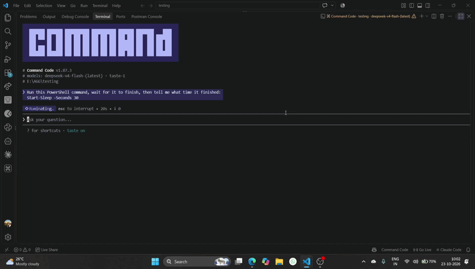

# doomscroller

Doomscroll while your AI coding agent works, then get pulled back when the agent finishes.

[](https://www.npmjs.com/package/@gurugokul/doomscroller)
[](https://github.com/Gurugokul05/doomscroller/blob/main/LICENSE)
[](#quick-start)



> **Demo GIF TODO:** Record an 8–12 second loop and save it as `docs/demo.gif`:
> submit a prompt → the agent window minimizes → Instagram/X opens → the agent
> finishes → the agent window returns. Keep it under ~5 MB. The
> `Ctrl+Alt+D` force-return should be visible in the clip.

## Why

AI agents spend a lot of time thinking. doomscroller turns that dead time into a
deliberate break: it moves focus to the next site in your rotation, then pulls
the agent window back when the agent is done. It is a small Windows utility, not
a productivity system.

## Quick start

1. **Install it globally:**

   ```powershell
   npm i -g @gurugokul/doomscroller
   ```

2. **Install your agent's hooks** (this also creates `~/.doomscroller.json`):

   ```powershell
   doomscroller init claude-code     # Claude Code
   doomscroller init command-code    # Command Code
   ```

   `init command-code` merges the hooks into `~/.commandcode/settings.json` the
   same way `init claude-code` does for Claude Code.

3. **Run your agent and submit a prompt:**

   ```powershell
   claude
   ```

   After `delaySeconds` (10 by default), the agent window is minimized and the
   first target opens in a new browser window. When Claude Code stops or emits a
   notification, the browser is minimized and the agent window returns. Press
   `Ctrl+Alt+D` at any time to force the return.

Requires Windows 10/11, Node.js 20+, and Windows PowerShell 5.1. If you use a
different agent, see the table below. For a terminal agent without hooks, use
`doomscroller run -- <command>`. To configure GUI windows, see
[Config](#config).

## Supported agents

"Working" means the adapter path is implemented and covered by tests.
"Experimental" means the adapter is implemented but has not been validated
against that agent's current release. "Planned" means it is not implemented.

| Agent | Adapter | Status | Notes |
| --- | --- | --- | --- |
| Claude Code | hook | Working | `doomscroller init claude-code` merges `UserPromptSubmit` → start and `Stop`/`Notification` → done into `~/.claude/settings.json`. Verify the hooks fire in your Claude Code version. |
| Command Code | hook | Working | `doomscroller init command-code` merges `PreToolUse` → start and `Stop` → done into `~/.commandcode/settings.json`. Command Code has no per-prompt hook, so a session starts on a turn's first tool call; hooks are skipped in plan mode. Verify the hooks fire in your Command Code version. |
| GitHub Copilot CLI | cli-wrapper | Experimental | `doomscroller run -- copilot`. Behavior depends on the CLI's terminal output. |
| Antigravity | ide-activity | Experimental | Match the window by process and/or title, set `workspace`, and press Enter in the window. |
| VS Code + Copilot | ide-activity | Experimental | Same heuristic. Use a generous `quietSeconds` and an absolute `workspace`. |
| Other GUI IDEs (Cursor, etc.) | ide-activity | Experimental | Add a `registeredAgents` entry with the app's process/title and a workspace. |
| Any foreground app | hotkey | Working | `Ctrl+Alt+D` starts a manual session when idle and force-returns when working. The global key press needs a real key to verify; see [Troubleshooting](#troubleshooting). |

A terminal agent without hooks can also be wrapped with
`doomscroller run -- <command>` (for example `doomscroller run -- cmdc`). The
hook path is more accurate for Command Code, because it no longer depends on
terminal silence to decide the session is finished.

macOS and Linux support is **planned**. The state machine and tests are
platform-neutral, but window control is Win32-only. See
[CONTRIBUTING.md](https://github.com/Gurugokul05/doomscroller/blob/main/CONTRIBUTING.md#adding-os-support)
for the `WindowController` interface.

## Config

`doomscroller init` (or `doomscroller init claude-code`) creates
`~/.doomscroller.json`. Every field is optional. Invalid values are ignored or
fall back to the defaults, and the tool keeps running.

```json
{
  "targets": [
    "https://www.instagram.com/",
    "https://x.com/",
    "https://www.youtube.com/shorts"
  ],
  "delaySeconds": 10,
  "quietSeconds": 15,
  "maxDoomscrollSeconds": 600,
  "hotkey": "Ctrl+Alt+D",
  "sound": true,
  "browser": "auto",
  "port": 45871,
  "idleCpuPercent": 5,
  "registeredAgents": [
    {
      "name": "Antigravity",
      "adapter": "ide-activity",
      "match": { "process": "Antigravity", "title": "Antigravity" },
      "workspace": "C:\\code\\my-project",
      "quietSeconds": 20
    }
  ],
  "logPath": "~/.doomscroller/doomscroller.log",
  "sessionLogPath": "~/.doomscroller/sessions.jsonl"
}
```

| Field | Default | Meaning |
| --- | --- | --- |
| `targets` | Instagram, X, YouTube Shorts | URLs rotated one per doomscroll session. An empty or invalid list falls back to the defaults. |
| `delaySeconds` | `10` | Grace period after `agent:started`. A `finished` event during the delay cancels the switch and no windows move. `0` switches immediately. |
| `quietSeconds` | `15` | CLI-wrapper silence before `agent:finished`, and the default inactivity window for IDE agents. Minimum `1`. |
| `maxDoomscrollSeconds` | `600` | Hard cap. On expiry the browser is minimized, the agent returns, and the session is logged with `end: "cap"`. `0` disables the cap. |
| `hotkey` | `"Ctrl+Alt+D"` | Global force-return / manual-start hotkey. Set to `null` to disable it. The shared Enter watcher still runs when IDE agents are configured. The watcher observes the key but does not swallow it from the foreground app. |
| `sound` | `true` | Play a short two-tone chime when a doomscroll session ends. |
| `browser` | `"auto"` | `auto`, `edge`, `chrome`, `brave`, `firefox`, or `default`. `auto` reads the Windows default browser for HTTPS and falls back to Edge/Chrome. `default` launches through the shell and detects a new window from a known browser process. |
| `port` | `45871` | Local daemon IPC port, bound to `127.0.0.1`. |
| `idleCpuPercent` | `5` | IDE finish threshold as a percentage of one CPU core. Activity at or below this is considered idle. |
| `registeredAgents` | one Antigravity entry | GUI windows for the IDE adapter. `[]` disables IDE activity. |
| `logPath` | `~/.doomscroller/doomscroller.log` | Daemon log. Absolute paths and `~/...` are supported. |
| `sessionLogPath` | `~/.doomscroller/sessions.jsonl` | Session records read by `doomscroller stats`. Absolute paths and `~/...` are supported. |

Each `registeredAgents` entry:

| Field | Required | Meaning |
| --- | --- | --- |
| `name` | Yes | Display name used in logs. |
| `adapter` | Yes | Use `ide-activity` for GUI windows. The other adapter names are accepted by config validation but only `ide-activity` is consumed by the IDE adapter. |
| `match.process` | No | Process name, case-insensitive, `.exe` ignored. |
| `match.title` | No | Case-insensitive substring of the window title. |
| `workspace` | No | Absolute path or `~/...` path to scan for modified files. Relative paths are resolved against the daemon's working directory, so prefer an absolute path. Without it, only CPU is used. |
| `quietSeconds` | No | Per-agent override for the global `quietSeconds`. |

At least one of `match.process` and `match.title` is required. If both are
provided, both must match.

Environment overrides, useful for tests and alternate installs:

- `DOOMSCROLLER_HOME` — base directory for config, logs, and sessions.
- `DOOMSCROLLER_CONFIG` — explicit config file path.
- `CLAUDE_CONFIG_DIR` — Claude Code config directory used by `init claude-code`.
- `COMMANDCODE_CONFIG_DIR` — Command Code config directory used by `init command-code`.

Use `doomscroller config` to print the config path and the effective merged
config. Use `doomscroller config --path` for only the path or
`doomscroller config --json` for only the JSON document.

## Safety

- **Opt-in.** doomscroller does not move windows until an adapter emits
  `agent:started` (a hook, Enter in a registered IDE window, `doomscroller
  start`, or the manual hotkey). There is no background observation of your
  screen.
- **Force return.** `Ctrl+Alt+D` force-returns to the saved agent window while
  working, and starts a session while idle. It is observed globally but not
  swallowed, so the foreground application also receives it. Change it in the
  config or set `hotkey: null` to disable it.
- **Hard cap.** `maxDoomscrollSeconds` (default 10 minutes) ends a session even
  if the agent never reports finished. Set it to `0` to disable the cap.
- **Delay before switching.** `delaySeconds` (default 10 seconds) gives short
  tasks a chance to finish before anything is minimized.
- **Failure isolation.** Adapters and hooks swallow errors, and the state
  machine serializes events so overlapping callbacks cannot interleave window
  operations. A failed browser launch or denied focus change does not crash the
  agent.
- **Non-destructive window handling.** The browser is minimized, not closed.
  The agent window handle is saved before minimizing and restored on finish,
  force-return, cap, or `doomscroller stop`.
- **Local only.** IPC binds to `127.0.0.1`. doomscroller has no telemetry and
  makes no external network requests beyond the browser you ask it to open.
- **Same elevation.** Run doomscroller at the same elevation as the agent.
  Windows can block focus changes between different integrity levels.

## Commands

| Command | What it does |
| --- | --- |
| `doomscroller init` | Create `~/.doomscroller.json` if it does not exist. |
| `doomscroller init claude-code` | Create the config and merge the Claude Code hooks into `~/.claude/settings.json`. Existing hooks are preserved, and `settings.json.doomscroller.bak` is created when the file already exists. |
| `doomscroller init command-code` | Create the config and merge the Command Code hooks into `~/.commandcode/settings.json` (`PreToolUse` → start, `Stop` → done). Existing hooks are preserved, and `settings.json.doomscroller.bak` is created when the file already exists. |
| `doomscroller start` | Emit `agent:started`. Hook-safe: exits quickly, never blocks the agent, and auto-starts the daemon if needed. |
| `doomscroller done` | Emit `agent:finished`. Same hook-safe behavior. |
| `doomscroller run -- <command>` | Run a terminal agent in a PTY. Enter starts, output resets the quiet timer, `quietSeconds` of silence or process exit finishes. |
| `doomscroller stats [--days N\|--all]` | Show doomscroll wait time per day from `sessions.jsonl`. Defaults to the last 14 days. |
| `doomscroller config [--path\|--json]` | Print the config path, whether it exists, and the effective merged config. |
| `doomscroller daemon` | Run the daemon in the foreground. Hooks and the wrapper normally auto-start it. |
| `doomscroller hotkey` | Alias for `doomscroller daemon`. |
| `doomscroller status` | Show `state=idle\|working\|done` and the current target. |
| `doomscroller stop` | Stop the daemon. If a session is active, restore the agent window first. |

`doomscroller --help` lists the same commands. `doomscroller --version` prints
the package version. `stats` shows time actually spent doomscrolling; sessions
that finish during the delay are counted with zero waiting time.

## How it works

The core is a small state machine in `src/core/state-machine.ts`:

```text
IDLE --agent:started--> WORKING --agent:finished--> DONE
           |                                |
           |  wait delaySeconds             |  minimize browser
           |  save + minimize agent         |  restore + focus agent
           |  open next target              |  chime + log session
           |                                |
           +---- hotkey / max cap ----------+
```

Adapters only emit the two events; they never move windows themselves. The
daemon hosts the adapters and exposes a localhost IPC endpoint:

- **hotkey** watches for the configured key.
- **hook** is the `doomscroller start` / `doomscroller done` pair, plus the
  Claude Code and Command Code settings mergers.
- **cli-wrapper** runs a command in a PTY and derives start/finish from Enter,
  output, silence, and process exit.
- **ide-activity** watches Enter in registered windows, then uses workspace
  mtimes and process-tree CPU to decide when the agent is idle.

Window operations go through the `WindowController` interface
(`src/windows/window-controller.ts`). The Win32 implementation shells out to
`scripts/win32-window.ps1`, which uses `GetForegroundWindow`, `ShowWindow`, and
`SetForegroundWindow`. Before focusing, it attaches to the foreground thread and
taps Alt to release Windows' foreground lock.

Target rotation is held in memory and starts at the first target again when the
daemon restarts. Sessions are appended to `sessions.jsonl`, and `stats` groups
them by local finish date.

## Troubleshooting

### Windows focus is not returned to the agent

Windows refuses `SetForegroundWindow` from processes that do not own the
foreground lock. doomscroller applies the standard workaround: `AttachThreadInput`
plus a synthetic Alt tap before focusing, with one retry. Some elevated, UWP, or
custom-chrome windows still refuse. Run the daemon at the same elevation as the
agent; if the focus attempt is not confirmed, check
`~/.doomscroller/doomscroller.log` and use `Ctrl+Alt+D` to retry. If focus moves
when you did not expect it, raise `delaySeconds`, lower
`maxDoomscrollSeconds`, or set `hotkey: null`.

### Claude Code hooks are not firing

Confirm that `doomscroller --version` works in the same shell Claude Code uses.
Re-run `doomscroller init claude-code`; it prints the settings path and the
events it added or found. Check `~/.claude/settings.json` (or the directory in
`CLAUDE_CONFIG_DIR`) for the three commands and make sure they point at this
installation's `dist/index.js`. Invalid settings JSON is never overwritten; fix
the JSON or restore `settings.json.doomscroller.bak`. Then check
`doomscroller status` and the daemon log. If the daemon cannot start, the hook
still exits cleanly, but no session begins.

### Command Code hooks are not firing

Confirm that `doomscroller --version` works in the same shell Command Code uses.
Re-run `doomscroller init command-code`; it prints the settings path and the
events it added or found. Check `~/.commandcode/settings.json` (or the directory
in `COMMANDCODE_CONFIG_DIR`) for the `PreToolUse` and `Stop` groups. Invalid
settings JSON is never overwritten; fix the JSON or restore
`settings.json.doomscroller.bak`. Two behaviors are expected: hooks are skipped
while Command Code is in plan mode, and start fires on a turn's first tool call,
so a turn that makes no tool calls never starts a session. Check
`doomscroller status` and the daemon log.

### `ide-activity` says "finished" too early

The IDE adapter is a heuristic. It finishes after `quietSeconds` with no
workspace mtime changes and CPU at or below `idleCpuPercent`. An agent that is
thinking with no file writes and little CPU looks idle. Increase the global or
per-agent `quietSeconds`, make sure `workspace` points at the real project, and
lower `idleCpuPercent` if small CPU bursts should count as activity. If the
agent offers hooks or runs in a terminal, the hook or cli-wrapper adapters are
more deterministic. Press Enter in the registered window to start a session.

### The browser window was not detected

doomscroller only recognizes new windows from Edge, Chrome, Brave, Firefox,
Opera, Vivaldi, and Arc. Set `browser` to `edge` or `chrome`, or use `default`
if your default browser is in that list. A browser that reuses an existing
window instead of creating a new one may not produce a detectable handle.

### The hotkey does nothing

The watcher polls `GetAsyncKeyState` every 15 ms. Test it with a real key press
while another application is focused; synthetic `SendKeys` input does not
reliably update the async key state in non-interactive sessions. Check the log,
make sure the daemon is running, and avoid remote-desktop or VM layers that
capture the keyboard.

### `node-pty` fails to load

`doomscroller run` needs the native `node-pty` module. Run `npm rebuild
node-pty`. If that fails, install Visual Studio Build Tools with the C++ desktop
workload and rebuild. The other adapters do not need node-pty.

### Stats are empty

Sessions are written by the daemon to `~/.doomscroller/sessions.jsonl` when a
session ends. Ensure at least one `start`/`finished` pair reached the daemon,
then run `doomscroller stats`. `doomscroller status` shows whether the daemon is
running.

## Contributing

Contributions are welcome. See
[CONTRIBUTING.md](https://github.com/Gurugokul05/doomscroller/blob/main/CONTRIBUTING.md)
for the dev setup, adapter example, OS-support notes, and PR checklist. Bugs and
agent requests have issue templates in `.github/ISSUE_TEMPLATE/`.

## License

MIT © 2026 Gurugokul. See
[LICENSE](https://github.com/Gurugokul05/doomscroller/blob/main/LICENSE).
